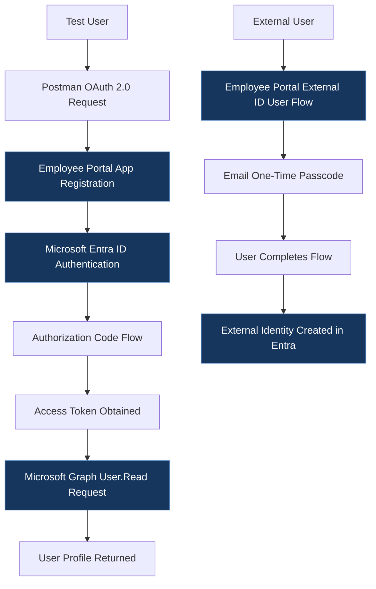

# Microsoft Entra ID Identity Lab

## Overview
This project documents hands-on work with Microsoft Entra ID, application registration, authentication testing, and self-service sign-up.

The goal is to demonstrate practical identity and access management (IAM) concepts through configuration, testing, and documentation.

## Objectives
- Configure and document an application registration.
- Test authentication flows using Postman.
- Document the self-service sign-up configuration and user journey.
- Capture the configuration and test results with screenshots.

## Lab Components

### 1. App Registration
Description of the application registration, relevant settings, and configuration decisions.

[View app registration documentation](app-registration/README.md)

### 2. Authentication Testing with Postman
Description of the authentication tests performed, expected behavior, and observed results.

[View authentication testing documentation](authentication-testing/README.md)

### 3. Self-Service Sign-Up
Description of the configuration, user flow, testing process, and results.

[View self-service sign-up documentation](self-service-signup/README.md)

## Architecture and Workflow

## Architecture and Workflow

## Key Learnings

Through these labs, I gained practical experience with Microsoft Entra ID application registration, OAuth 2.0 authentication, Microsoft Graph permissions, and external identity onboarding.

- **Application Registration:** Learned how to configure a single-tenant application, set a redirect URI for Postman, and review delegated Microsoft Graph permissions.
- **OAuth 2.0 Authentication:** Tested the Authorization Code flow in Postman and successfully obtained an access token to authenticate a Microsoft Graph request.
- **Microsoft Graph:** Used the delegated `User.Read` permission to retrieve the signed-in user's profile and verify that authentication and API access were working.
- **External Identity Management:** Configured a Microsoft Entra External ID user flow using email-based one-time passcodes and verified that an external identity account was created.
- **Authentication Testing and Troubleshooting:** Practised initiating authentication requests, completing the sign-in process, and checking the resulting identity and API response.
- **Security Awareness:** Explored how application credentials and access tokens must be protected, why sensitive information should be excluded from public repositories, and why production authentication configurations require additional security review.

This project strengthened my understanding of identity and access management (IAM) and gave me hands-on experience connecting application registration, authentication, and identity verification workflows.

## Disclaimer
This project was conducted in a sandbox environment for educational and testing purposes. It demonstrates hands-on exploration of Microsoft Entra ID application registration, OAuth 2.0 authentication, Microsoft Graph permissions, and Microsoft Entra External ID self-service sign-up.

The configuration is intended for learning and demonstration, not as a production-ready implementation. Security settings and authentication flows should be reviewed and adapted before use in a real-world environment. Sensitive credentials and personal information have been excluded from published materials.
