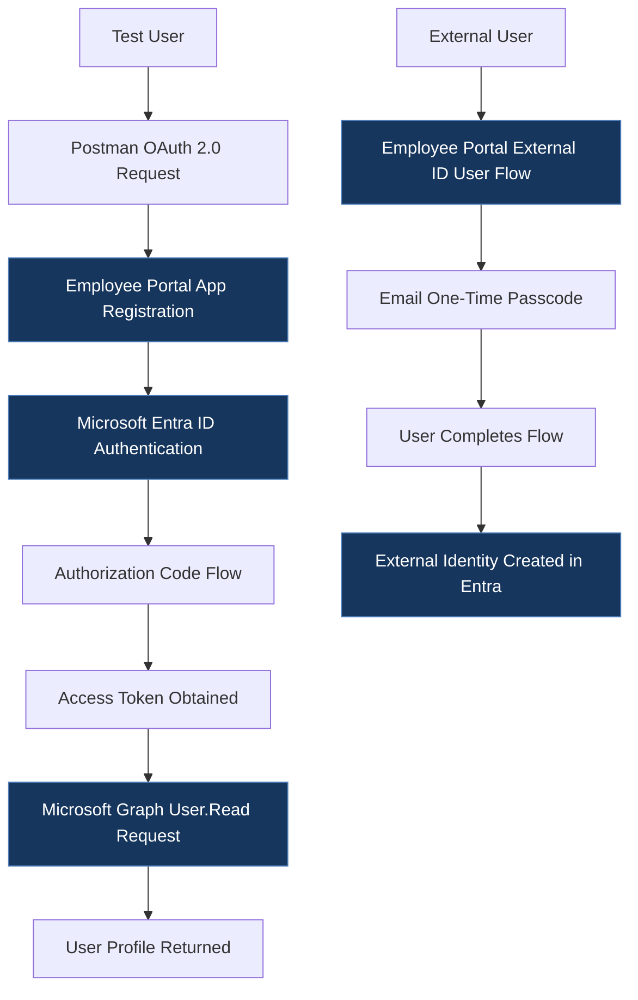

# Microsoft Entra ID Identity Lab

## Overview
This project documents hands-on work with Microsoft Entra ID, application registration, authentication testing, and self-service sign-up.

The goal is to demonstrate practical identity and access management (IAM) concepts through configuration, testing, and documentation.

## Objectives
- Configure and document an application registration.
- Test authentication flows using Postman.
- Document the self-service sign-up configuration and user journey.
- Capture the configuration and test results with screenshots.

## Lab Components

### 1. App Registration
Description of the application registration, relevant settings, and configuration decisions.

[View app registration documentation](app-registration/README.md)

### 2. Authentication Testing with Postman
Description of the authentication tests performed, expected behavior, and observed results.

[View authentication testing documentation](authentication-testing/README.md)

### 3. Self-Service Sign-Up
Description of the configuration, user flow, testing process, and results.

[View self-service sign-up documentation](self-service-signup/README.md)

## Architecture and Workflow

## Architecture and Workflow

## Key Learnings
Document the IAM concepts learned, issues encountered, and how they were resolved.

## Security and Scope
This is a documented lab environment. Screenshots and examples are sanitized to avoid exposing credentials, tokens, tenant identifiers, or personal information.

## Disclaimer
This project is for educational and portfolio purposes. Configuration and test results are specific to the lab environment.
