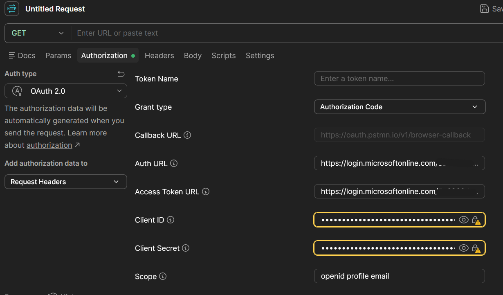
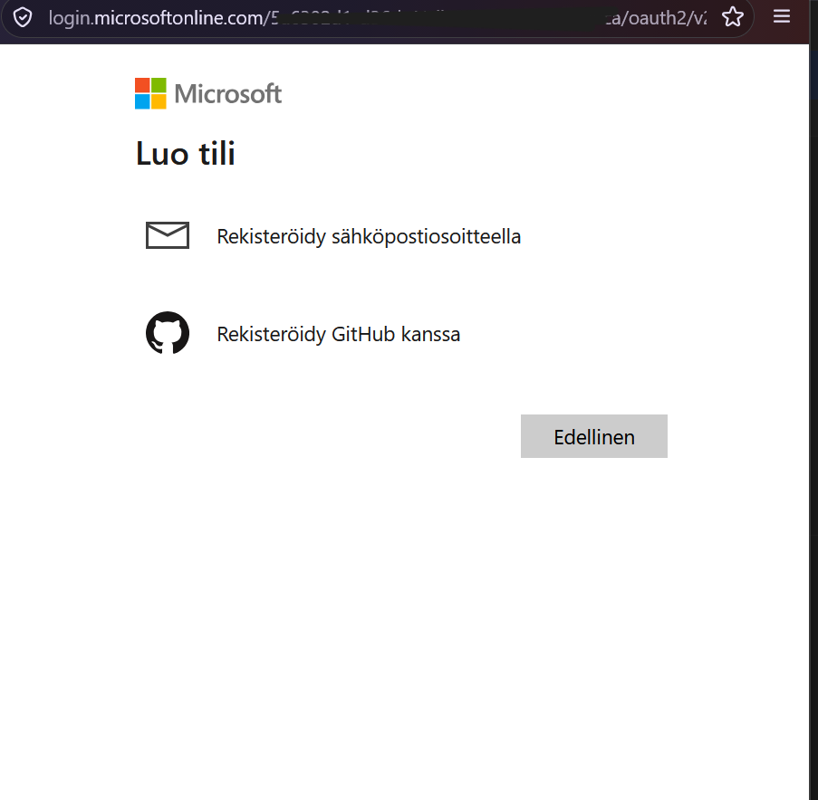
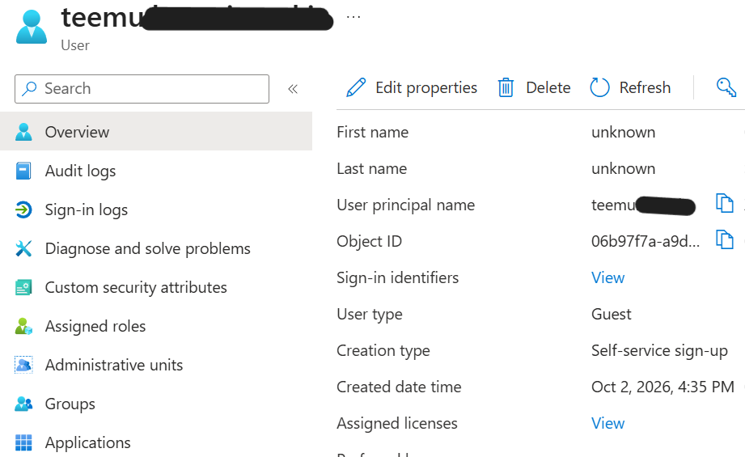

# Microsoft Entra External ID — Self-Service Sign-Up

## Overview

This component of my Microsoft Entra ID Identity Lab explores self-service sign-up using Microsoft Entra External ID for the mock Employee Portal application.

I configured a user flow using a one-time passcode (OTP) sent to the user's email address and tested the sign-in and external identity creation process using Postman.

## Configuration

I configured an External ID user flow for Employee Portal with email-based one-time passcode authentication.

The purpose was to explore how an external user can authenticate using an email address and a temporary passcode, without relying on a conventional password-based sign-in in this test scenario.

## Test Procedure

### 1. Initiate the Authentication Flow

I crafted an OAuth authorization request in Postman to initiate the authentication process for Employee Portal.

### 2. Select an Account

When prompted to sign in, I selected **Use another account** and entered my own email address to test the external user journey.

### 3. Verify the One-Time Passcode

I received a one-time passcode at the email address I entered and used it to continue the authentication flow.

### 4. Verify External Identity Creation

After completing the flow, I checked Microsoft Entra and confirmed that an external identity account had been created. The account appeared with the `ext_account` identity classification.

## Results

The test demonstrated that:

- The Employee Portal user flow could initiate email-based one-time passcode authentication.
- The passcode was delivered to the email address used in the test.
- The authentication journey progressed through the configured user flow.
- An external identity account was created and visible in Microsoft Entra.

## Key Learnings

- How Microsoft Entra External ID user flows support external-user onboarding.
- How email-based one-time passcodes can be used in an authentication journey.
- How to initiate and test an OAuth authorization request using Postman.
- How to verify the resulting external identity in Microsoft Entra.

## Security and Scope

This was a lab exercise using a test account and a mock application. Screenshots and examples published in this repository are sanitized to avoid exposing personal information, authentication codes, tokens, or other sensitive data.
